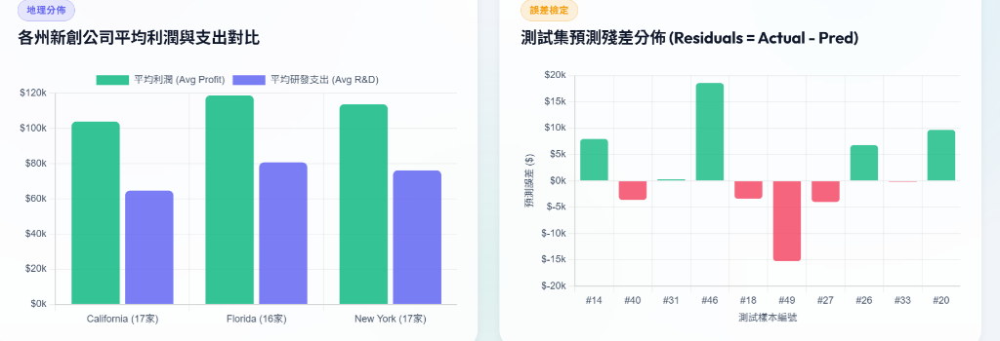
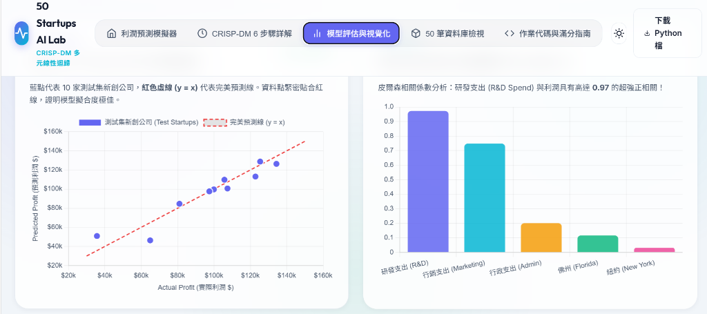
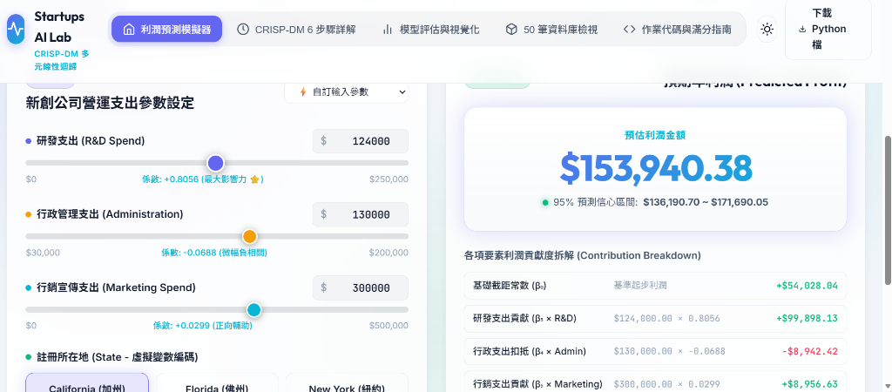
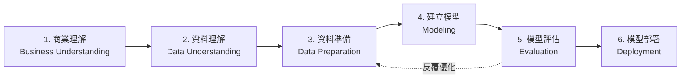

# 🚀 50 Startups 多元線性迴歸與 CRISP-DM 實戰分析平台
> **50 Startups Multiple Linear Regression & Machine Learning Interactive Lab**

[](https://www.python.org/)
[](https://scikit-learn.org/)
[](https://www.chartjs.org/)
[](#-前端互動平台特色)
[](#-crisp-dm-六大標準步驟實作)

本專案基於 **CRISP-DM (Cross-Industry Standard Process for Data Mining)** 資料探勘標準流程，針對經典的 **50 家美國新創公司資料集 (50 Startups Dataset)** 進行端到端的機器學習建模與全方位視覺化互動分析。

專案結合了 **Python 機器學習後端演算法**（多元線性迴歸、One-Hot 編碼避開虛擬變數陷阱、前向特徵選擇）與**現代化暗黑/明亮主題前端儀表板**，提供創投決策者、資料科學家與學生直觀的參數模擬器與模型評估工具。

---

## 📸 網站頁面預覽 (Web UI Previews)

平台具備現代化響應式介面，支援即時運算、動態圖表呈現與多資料集切換：

### 1. 🎛️ 即時利潤預測模擬器 (Profit Predictor Simulator)
使用者可透過滑桿動態調整**研發支出 (R&D Spend)**、**行政支出 (Administration)**、**行銷推廣支出 (Marketing Spend)** 以及**註冊州別 (California / Florida / New York)**，系統即時計算出預測利潤、95% 信心區間與各項財務要素的貢獻度拆解。


*▲ 圖 1：即時利潤預測模擬器與迴歸要素貢獻度分解（Contribution Breakdown）*

---

### 2. 🔄 多模式與前向特徵選擇切換 (Dataset Modes & Selection)
頂部快速切換列支援多種分析模式：
- **Dataset 1 — MLR 多元線性迴歸** (harimittapalli 資料集，全變數分析)
- **Dataset 2 — Forward Selection 前向特徵選擇** (GaneshSparkz 資料集，特徵逐步最佳化)
- **自訂資料輸入模式** (輸入新創公司資料進行自訂預測)


*▲ 圖 2：分析模式與特徵選擇方案切換*

---

### 3. 📊 模型評估與視覺化分析 (Model Evaluation & Visualizations)
整合 Chart.js 提供互動式圖表，深入剖析模型配適度與變數關聯性：
- **實際值 vs 預測值散佈圖**（紅虛線 $y = x$ 完美配適線，測試集擬合極佳）
- **皮爾森相關係數分析**（揭示 R&D Spend 與 Profit 具有高達 **0.97** 的超強正相關）


*▲ 圖 3：測試集預測散佈圖 (Actual vs. Predicted) 與變數相關性柱狀圖*

---

### 4. 🗺️ 地理分佈對比與測試集殘差分佈 (Geography & Residuals)
- **各州新創公司平均利潤與支出對比**：直觀呈現 California、Florida、New York 三地的平均利潤與平均 R&D 支出水平。
- **測試集預測殘差分佈 (Residuals = Actual - Predicted)**：快速診斷每一筆測試樣本的預測誤差，確認無系統性偏差。


*▲ 圖 4：各州營運表現對比長條圖與各測試樣本殘差分佈檢驗*

---

## ✨ 核心功能特色

- **🎯 雙模式機器學習演算法**：
  - **標準多元線性迴歸 (MLR)**：使用 `scikit-learn`，嚴格執行 OneHotEncoding 並刪除首個虛擬變數（`drop='first'`），徹底避免虛擬變數陷阱 (Dummy Variable Trap)。
  - **前向特徵選擇 (Forward Feature Selection)**：逐步迭代選取使測試集 RMSE 最小、判定係數 $R^2$ 最大的特徵組合。
- **💡 視覺化預測公式與貢獻拆解**：
  $$\text{Profit} = \beta_0 + \beta_1 \cdot \text{R\&D} + \beta_2 \cdot \text{Admin} + \beta_3 \cdot \text{Marketing} + \beta_4 \cdot \text{Florida} + \beta_5 \cdot \text{New York}$$
  介面逐行呈現每項支出的加權貢獻金額與扣抵數值。
- **📉 完整模型指標儀表板**：
  - **判定係數 $R^2$**：達到 **0.8987**（測試集可解釋約 90% 的利潤變異）。
  - **平均絕對誤差 (MAE)**：約 **$6,961**。
  - **均方根誤差 (RMSE)**：約 **$9,056**。
- **🌓 現代化 UI / UX 設計**：
  - 支援深色模式 (Dark Mode) 與淺色模式 (Light Mode) 一鍵切換。
  - 完整的 50 筆原始資料瀏覽表格（支援即時搜尋、州別篩選與排序）。
  - 完整 Python 原始碼線上檢視與一鍵下載功能。

---

## 🧠 CRISP-DM 六大標準步驟實作

本專案嚴格遵循資料科學標準方法論 **CRISP-DM**：



1. **商業理解 (Business Understanding)**：
   探討研發、行政與行銷支出如何驅動新創獲利，協助創投 (VC) 辨別高潛力團隊。
2. **資料理解 (Data Understanding)**：
   分析 50 筆新創公司的財務數值分佈，檢驗各州比例，確認無缺失值 (NaN)。
3. **資料準備 (Data Preparation)**：
   類別變數 `State` 進行 One-Hot 編碼，並剔除參考類別避免多重共線性 (Multicollinearity)。
4. **建立模型 (Modeling)**：
   採 80/20 比例拆分訓練集 (40 筆) 與測試集 (10 筆)，訓練多元線性迴歸模型。
5. **模型評估 (Evaluation)**：
   透過 $R^2$、MAE、MSE、RMSE 與殘差分析圖檢驗泛化能力。
6. **模型部署 (Deployment)**：
   將模型係數與邏輯封裝至輕量級網頁前端，提供終端用戶即時預測模擬。

---

## 📁 專案檔案結構

```text
DIC2-2/
├── index.html                     # 平台主頁面 (HTML5 結構與語義化標籤)
├── style.css                      # 現代化樣式表 (深淺主題、玻璃擬物化、響應式排版)
├── app.js                         # 前端邏輯 (互動事件、即時計算、Chart.js 圖表渲染)
├── startup_regression.py          # Python 後端完整 CRISP-DM 6 步驟實作程式碼
├── run_forward_selection.py       # 前向特徵選擇 (Forward Selection) 實驗腳本
├── model_results.json             # MLR 模型訓練指標、權重係數與測試集預測資料
├── forward_selection_results.json # 前向特徵選擇每一步驟最佳特徵與誤差成果
├── startups_data.json             # 50 筆新創公司本機 JSON 快取
├── actual_vs_predicted.png        # Matplotlib 輸出的預測對比圖
├── screenshots/                   # README 頁面預覽截圖
│   ├── 01_profit_predictor.png    # 利潤預測模擬器截圖
│   ├── 02_dataset_modes.png       # 模式下拉切換截圖
│   ├── 03_model_evaluation.png    # 散佈圖與相關性長條圖截圖
│   └── 04_residuals_and_states.png# 地理與殘差分佈截圖
└── README.md                      # 專案詳細說明文件 (本檔案)
```

---

## ⚡ 快速開始 (Quick Start)

### 1. 運行前端網頁平台
無需安裝複雜的 Web 伺服器環境，你可以直接透過以下任一方式開啟：

- **方法 A (直接開啟)**：在檔案總管中雙擊 `index.html` 即可在瀏覽器中運行。
- **方法 B (VS Code Live Server)**：在 VS Code 中安裝擴充套件「Live Server」，右鍵點擊 `index.html` 選擇 **"Open with Live Server"**。
- **方法 C (Python 內建 HTTP Server)**：
  ```bash
  python -m http.server 8000
  ```
  接著在瀏覽器造訪 `http://localhost:8000`。

### 2. 執行 Python 機器學習腳本
確保本機環境已安裝必要套件：
```bash
pip install numpy pandas scikit-learn matplotlib requests
```

執行多元線性迴歸完整分析：
```bash
python startup_regression.py
```

執行前向特徵選擇演算法：
```bash
python run_forward_selection.py
```

---

## 📈 重要發現與商業洞見

1. **研發支出是獲利核心驅動力**：
   - 相關係數高達 **0.97**，迴歸權重最大（$\beta \approx 0.8056$）。新創每增加 $1 的研發支出，預期利潤提升約 $0.80。
2. **行銷支出具正面輔助效益**：
   - 相關係數為 **0.74**，具顯著正向影響（$\beta \approx 0.0299$）。
3. **行政管理支出與利潤無顯著正相關**：
   - 係數微幅為負（$\beta \approx -0.0688$），過高的行政支出並不會帶動盈利增長。
4. **地理位置對利潤影響極微**：
   - 前向特徵選擇顯示，僅需使用 `R&D Spend` 或搭配 `Marketing Spend` 即可達成最佳模型配適度，州別變數對利潤預測貢獻邊際效益低。

---

## 📜 資料來源與致謝
- 資料集來源：[harimittapalli/50_Startups](https://github.com/harimittapalli) & [GaneshSparkz/50_Startups](https://gist.github.com/GaneshSparkz)
- 圖表函式庫：[Chart.js](https://www.chartjs.org/)
- 字型支援：[Google Fonts (Inter & Outfit)](https://fonts.google.com/)
